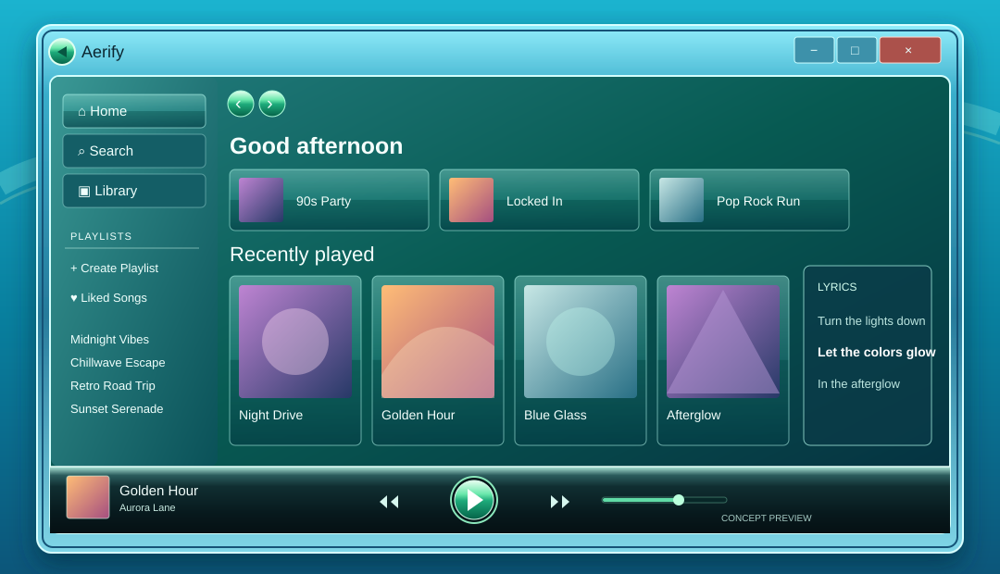

# Aerify

A glassy Windows Vista / Windows 7 inspired Spicetify theme. It gives Spotify a teal Aero frame, translucent Media Center tiles, and a dark Windows Media Player transport deck. It also styles [Spicy Lyrics](https://github.com/Spikerko/spicy-lyrics)' full-screen lyrics and picture-in-picture popup as an Aero mini player.



## Install

1. Install [Spotify desktop and Spicetify](https://spicetify.app/docs/getting-started/).
2. Copy this repository into your Spicetify `Themes` folder as `Aerify`. On Windows that folder is `%appdata%\spicetify\Themes\Aerify`; on macOS/Linux it is `~/.config/spicetify/Themes/Aerify`.
3. Run:

   ```sh
   spicetify config current_theme Aerify color_scheme Aero
   spicetify config inject_css 1 replace_colors 1 inject_theme_js 1
   spicetify apply
   ```

`Aero Blue` is an alternate color scheme: `spicetify config color_scheme "Aero Blue"`, then `spicetify apply`.

## Lyrics and mini player

Install [Spicy Lyrics](https://github.com/Spikerko/spicy-lyrics) separately through Spicetify Marketplace. Its full-screen page gets Aerify's frosted background and luminous active line. Its **Spicy Popup Lyrics** button opens the picture-in-picture mini player, which receives the same Aero frame and transport styling. Aerify does not bundle or modify Spicy Lyrics, and lyrics availability depends on that extension and its sources.

`theme.js` paints both Spicy Lyrics' picture-in-picture window and Spotify's native Document Picture-in-Picture mini player. It runs only when the browser exposes that API. Spotify changes its mini player markup between releases; shared window and button styling is resilient, while finer control styling may need updates.

The bottom-left player shows the next queued song beneath the current track. It reads Spicetify's queue locally, updates on song changes and at a low frequency while the window is visible, and never starts playback or makes network requests.

## Development

- `color.ini` defines Spicetify's semantic colors.
- `user.css` styles Spotify and the optional Spicy Lyrics extension.
- `theme.js` styles separate picture-in-picture windows.
- `preview/aerify-preview.svg` is a concept illustration for the visual direction, not a screenshot of a live Spotify installation.

The theme uses native Spotify playback and navigation. Its script paints picture-in-picture documents and displays a single queue preview. No external fonts, network calls, or lyric provider credentials are included. CSS selectors may need maintenance after Spotify or Spicy Lyrics updates.

## Credits

Visual inspiration: Windows Vista / Windows 7 Aero, Windows Media Player, the supplied Aerify reference image, and the Aero material in [WMPotify](https://github.com/Ingan121/WMPotify). Aerify retains Spotify's current navigation and does not include WMPotify code. Spicy Lyrics remains a separate project by its maintainers.
