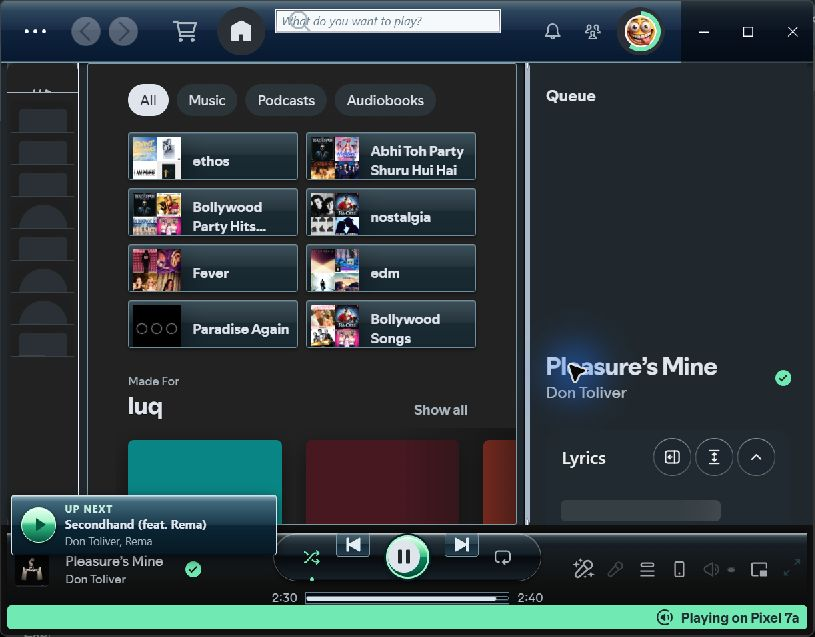

# Aerify

Aerify is a dark Windows Media Player and Windows 7 Aero inspired Spicetify theme. It uses WMPotify's source-level control and layout patterns to style Spotify's main window with a graphite content surface, charcoal sidebar, black transport, cyan highlights, and a green play control. Spotify's navigation and playback behavior stay in place. The theme uses Spotify's native window shell; it draws no outer border, fake title bar, or replacement window buttons.



This is an actual Spotify window captured on October 31, 2026. The library was collapsed and playback was on the user's phone when captured.

## Install

1. Install [Spotify desktop and Spicetify](https://spicetify.app/docs/getting-started/).
2. Copy this repository into your Spicetify `Themes` folder as `Aerify`. On Windows, use `%appdata%\spicetify\Themes\Aerify`; on macOS or Linux, use `~/.config/spicetify/Themes/Aerify`.
3. Enable the theme and its small queue card script:

   ```sh
   spicetify config current_theme Aerify color_scheme Aero
   spicetify config inject_css 1 replace_colors 1 inject_theme_js 1
   spicetify apply
   ```

`Aero Blue` is an alternate scheme: run `spicetify config color_scheme "Aero Blue"` and apply again.

## Up next

A separate card above the bottom-left player appears when a next song is known. It checks Spotify's queue and player state, then the visible Now Playing panel if needed. It disappears when no next song can be identified. The script reads local state, updates on song changes and infrequently while the window is visible, and never starts playback or makes network requests.

## Development

- `color.ini` defines the Spicetify color schemes.
- `user.css` styles Spotify's main window.
- `theme.js` renders only the conditional Up next card.
- A live Spotify screenshot is the visual reference for each completed design pass. Earlier captures show earlier versions.

Check `theme.js` with `node --check theme.js`, run the queue tests with `node --test tests/queue-glance.test.js`, and inspect the applied theme in Spotify. A real screenshot is needed to verify visual changes.

## Credits and license

Aerify takes visual direction and a source foundation from Windows Media Player and [WMPotify](https://github.com/Ingan121/WMPotify). The upstream SCSS used for this rebuild is preserved in `upstream/WMPotify/`; `user.css` adapts its Aero controls, panels, and transport styling under the MIT license. See [THIRD_PARTY_NOTICES.md](THIRD_PARTY_NOTICES.md) for the copyright notice and source links. Aerify does not include WMPotify's image resources or application code.
